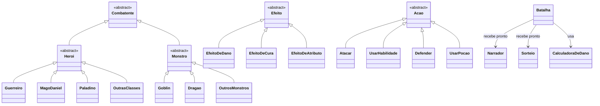

# RPG do Oliver Tree

Jogo de RPG por turnos que roda no navegador, feito em **HTML, CSS e JavaScript puro** (sem frameworks e sem instalar nada), aplicando os conceitos de **Programação Orientada a Objetos** e os princípios **SOLID**.

🎮 **Jogar online:** _(https://rpg-do-oliver-tree.onrender.com)_

---

## Como jogar

O jogo tem três passos, um em cada página:

1. **Personagem**: escolha o nome e a classe e distribua 30 pontos entre os atributos (ou use o botão *Recomendado para a classe*).
2. **Monstro**: escolha um monstro e o nível, ou deixe o jogo sortear.
3. **Batalha**: lute por turnos usando *Atacar*, *Habilidade*, *Defender* e *Poção* (teclas 1 a 4), ou ative a *Batalha automática*.

Vencer dá experiência, e o herói sobe de nível até o nível 20. O herói e o monstro ficam salvos no navegador, então cada página continua de onde a anterior parou.

## Como rodar no computador

Baixe o projeto e abra o arquivo `index.html` no **Chrome** ou no **Edge**. Não precisa instalar nada nem rodar servidor.

---

## O que o jogo tem

- **8 classes de herói**, cada uma com fórmulas de atributos e uma habilidade especial própria: Guerreiro, Mago Daniel, Arqueira Diovana, Paladino, Bardo, Ladino, Druida Vianey e Bárbaro.
- **10 monstros**: Goblin, Ogro, Dragão, Lich, Minotauro, Quimera, Basilisco, Mantícora, Hidra e Gárgula.
- **4 tipos de dano**: físico e mágico (reduzidos pela defesa), veneno e espiritual (reduzidos pela resistência).
- **Efeitos de status**: veneno, queimadura, cura contínua, fúria, petrificação, atordoamento e outros.
- **Vantagens e fraquezas**: cada classe é forte contra alguns monstros e fraca contra outros (+25% de dano).
- **Críticos, esquiva, poções, recarga de habilidades, XP e níveis.**
- **Balanceamento testado por simulação**: contra um monstro do mesmo nível o herói vence cerca de 85% das vezes; com o monstro 1 nível acima, cerca de 60%.

---

## Organização do código

```
index.html        1. criação do personagem
monstro.html      2. geração do monstro
batalha.html      3. arena de batalha
testes.html       testes automáticos das regras do jogo

js/
├── util.js       funções auxiliares e a classe Sorteio
├── dados.js      números do jogo (vida, dano, defesas, vantagens...)
├── modelo/       classes do jogo: Combatente, Heroi, Monstro, Efeito e subclasses
├── batalha/      regras da luta: Batalha, Acao, CalculadoraDeDano, Narrador
└── telas/        componentes da página: formulário, ficha, gerador e arena
```

## POO e SOLID



| Conceito | Onde aparece |
|---|---|
| **Herança** | `Combatente` → `Heroi` / `Monstro` → cada classe e cada monstro. `Efeito` e `Acao` também têm subclasses. |
| **Abstração** | `Combatente`, `Heroi`, `Monstro`, `Efeito` e `Acao` são abstratas e não podem ser criadas diretamente. |
| **Encapsulamento** | HP, MP, estatísticas, efeitos e recarga são campos privados (`#hp`, `#mp`...) e só mudam pelos métodos da classe. |
| **Polimorfismo** | Cada classe implementa sua própria `usarHabilidade()`; cada efeito responde `aoIniciarTurno()` do seu jeito. |
| **S** - Responsabilidade Única | A `Batalha` só controla os turnos. O dano é calculado pela `CalculadoraDeDano`, os textos ficam no `Narrador` e a tela fica na pasta `telas/`. |
| **O** - Aberto/Fechado | Uma classe, um monstro, um efeito ou uma ação nova é só uma classe nova, sem mexer na `Batalha`. |
| **L** - Substituição de Liskov | A `Batalha` trata qualquer herói e qualquer monstro da mesma forma. |
| **I** - Segregação de Interface | A habilidade especial não fica na classe base: o **Goblin não tem** e o jogo funciona normalmente com ele. |
| **D** - Inversão de Dependência | A `Batalha` recebe o `Narrador` e o `Sorteio` prontos pelo construtor. Por isso os testes trocam esses objetos por versões próprias sem alterar a `Batalha`. |

O diagrama completo e mais detalhes estão em [`diagrama-classes.md`](diagrama-classes.md).

## Testes

Abra `testes.html` para rodar os 15 testes das regras do jogo: classes abstratas, herança, encapsulamento, fórmula de dano, efeitos, XP, salvamento, entre outros. Cada linha verde é um teste que passou.
