# Diagrama de classes

Para ver o desenho, cole o bloco abaixo em https://mermaid.live (ou no mermaid.ai).

```mermaid
classDiagram
    direction TB

    %% ---------- Modelo ----------
    class Combatente {
        <<abstract>>
        -base
        -hp
        -mp
        -efeitos
        -recarga
        +nome
        +nivel
        +receberDano(valor) int
        +curar(valor) int
        +getStat(nome) number
        +adicionarEfeito(efeito)
        +podeUsarHabilidade() bool
        +iniciarRecarga()
        +diminuirRecarga()
        +getTitulo() string
        +ehDaClasse(classe) bool
        +multiplicadorContra(alvo) number
        +aoFimDoTurno(batalha)
        +escolherAcao(batalha)*
    }

    class Heroi {
        <<abstract>>
        +classe
        +atributos
        +xp
        +calcularEstatisticas()$
        +carregar(dados)$ Heroi
        +ganharXp(quantidade) int
        +estaNoNivelMaximo() bool
        +paraSalvar()
        +ehDaClasse(classe) bool
        +escolherAcao(batalha) string
    }

    class Monstro {
        <<abstract>>
        +fraquezas
        +vantagens
        +carregar(dados)$ Monstro
        +paraSalvar()
        +calcularXp(nivelDoHeroi) int
        +escolherAcao(batalha) string
    }

    Guerreiro : +usarHabilidade(alvo, batalha)
    MagoDaniel : +usarHabilidade(alvo, batalha)
    ArqueiraDiovana : +usarHabilidade(alvo, batalha)
    Paladino : +usarHabilidade(alvo, batalha)
    Bardo : +usarHabilidade(alvo, batalha)
    Ladino : +usarHabilidade(alvo, batalha)
    DruidaVianey : +usarHabilidade(alvo, batalha)
    Barbaro : +usarHabilidade(alvo, batalha)

    class Goblin
    note for Goblin "Sem habilidade especial (ISP)"
    Ogro : +regeneracao
    Ogro : +usarHabilidade(alvo, batalha)
    Ogro : +aoFimDoTurno(batalha)
    Dragao : +usarHabilidade(alvo, batalha)
    Lich : +usarHabilidade(alvo, batalha)
    Minotauro : +usarHabilidade(alvo, batalha)
    Quimera : +usarHabilidade(alvo, batalha)
    Basilisco : +usarHabilidade(alvo, batalha)
    Manticora : +usarHabilidade(alvo, batalha)
    Hidra : +usarHabilidade(alvo, batalha)
    Gargula : +usarHabilidade(alvo, batalha)

    Combatente <|-- Heroi
    Combatente <|-- Monstro
    Heroi <|-- Guerreiro
    Heroi <|-- MagoDaniel
    Heroi <|-- ArqueiraDiovana
    Heroi <|-- Paladino
    Heroi <|-- Bardo
    Heroi <|-- Ladino
    Heroi <|-- DruidaVianey
    Heroi <|-- Barbaro
    Monstro <|-- Goblin
    Monstro <|-- Ogro
    Monstro <|-- Dragao
    Monstro <|-- Lich
    Monstro <|-- Minotauro
    Monstro <|-- Quimera
    Monstro <|-- Basilisco
    Monstro <|-- Manticora
    Monstro <|-- Hidra
    Monstro <|-- Gargula

    %% ---------- Efeitos ----------
    class Efeito {
        <<abstract>>
        +nome
        +duracao
        +restante
        +aoIniciarTurno(alvo, batalha)
        +bonus(estatistica) number
        +bonusPercentual(estatistica) number
        +multiplicadorDanoRecebido() number
        +impedeAcao() bool
    }
    class EfeitoDeDano
    class EfeitoDeCura
    class EfeitoDeAtributo
    Efeito <|-- EfeitoDeDano
    Efeito <|-- EfeitoDeCura
    Efeito <|-- EfeitoDeAtributo
    Efeito <|-- Inspirado
    Efeito <|-- Atordoado
    Efeito <|-- Defendendo
    EfeitoDeDano <|-- Envenenado
    EfeitoDeDano <|-- Queimando
    EfeitoDeCura <|-- Bencao
    EfeitoDeCura <|-- Regeneracao
    EfeitoDeAtributo <|-- MiraPrecisa
    EfeitoDeAtributo <|-- Furia
    EfeitoDeAtributo <|-- FormaDePedra
    EfeitoDeAtributo <|-- Petrificado

    %% ---------- Batalha ----------
    class Batalha {
        +heroi
        +monstro
        +turno
        +pocoes
        +jogarTurno(nomeDaAcao)
        +golpear(atacante, defensor, tipoDano, multiplicador) bool
        +aplicarEfeito(alvo, efeito, chance)
        +narrar(chave, dados)
    }
    class Acao {
        <<abstract>>
        +podeExecutar(ator, batalha) bool
        +executar(ator, alvo, batalha)*
    }
    Acao <|-- Atacar
    Acao <|-- UsarHabilidade
    Acao <|-- Defender
    Acao <|-- UsarPocao

    CalculadoraDeDano : +calcular(atacante, defensor, tipoDano, multiplicador, critico) int
    Sorteio : +numero() number
    Sorteio : +chance(porcentagem) bool
    Sorteio : +inteiro(min, max) int
    SorteioFixo : +numero() number
    Narrador : +narrar(chave, dados)
    MensagensPtBr : +texto(chave, dados) string
    SaidaNaTela : +escrever(chave, texto)
    SaidaNoConsole : +escrever(chave, texto)
    SaidaEmLista : +escrever(chave, texto)

    Sorteio <|-- SorteioFixo
    Batalha --> Combatente : heroi e monstro
    Batalha --> Acao : usa
    Batalha --> CalculadoraDeDano : usa
    Batalha --> Narrador : recebe pronto
    Batalha --> Sorteio : recebe pronto
    Narrador --> MensagensPtBr : textos
    Narrador --> SaidaNaTela : no jogo
    Narrador ..> SaidaNoConsole : na demonstração
    Narrador ..> SaidaEmLista : nos testes
    Combatente --> Efeito : tem vários
```

`SorteioFixo` e `SaidaEmLista` ficam em `js/testes.js` (página `testes.html`).

## Onde está cada princípio

| Princípio | Onde aparece no código |
|---|---|
| **Herança** | `Combatente` → `Heroi` / `Monstro` → cada classe e cada monstro. `Efeito`, `Acao` e `Sorteio` também têm subclasses. |
| **Abstração** | `Combatente`, `Heroi`, `Monstro`, `Efeito` e `Acao` não podem ser criadas direto (`new.target`). |
| **Encapsulamento** | `#base`, `#hp`, `#mp`, `#efeitos` e `#recarga` são privados em `Combatente`; só mudam pelos métodos dela (`receberDano()`, `curar()`, `iniciarRecarga()`...). |
| **Polimorfismo** | `usarHabilidade()` diferente em cada classe; `escolherAcao()` diferente em herói e monstro; cada efeito responde `aoIniciarTurno()` do seu jeito; `ehDaClasse()` responde diferente em herói e monstro. |
| **S** - Responsabilidade Única | A `Batalha` só controla os turnos. Contas de dano: `CalculadoraDeDano`. Textos: `Narrador` + `MensagensPtBr`. Tela: pasta `telas/`. Números do jogo: `dados.js`. |
| **O** - Aberto/Fechado | Efeito novo, ação nova, classe nova ou monstro novo = classe nova, sem mexer na `Batalha`. |
| **L** - Substituição de Liskov | A `Batalha` trata qualquer `Heroi` e qualquer `Monstro` do mesmo jeito, sem perguntar qual é a classe. O monstro pergunta `alvo.ehDaClasse()`, que todo `Combatente` sabe responder. |
| **I** - Segregação de Interface | A habilidade especial não fica na classe base: só quem tem implementa `usarHabilidade()`. O **Goblin não tem** (igual ao exemplo do professor) e a batalha funciona normalmente com ele (`temHabilidadeEspecial()` faz o papel do `instanceof ComHabilidadeEspecial`). |
| **D** - Inversão de Dependência | A `Batalha` recebe o `Narrador` e o `Sorteio` prontos pelo construtor. Por isso os testes trocam o sorteio por um `SorteioFixo` e a saída por uma `SaidaEmLista` sem mudar nada na `Batalha`. |
