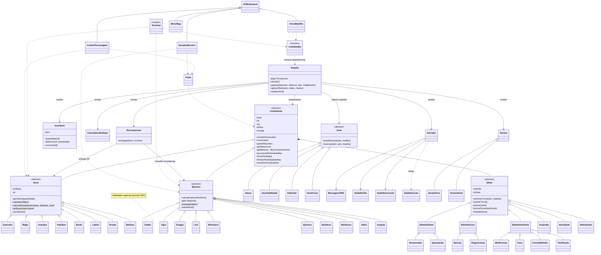

# Diagrama de classes

Diagrama do núcleo e dos adaptadores de interface. Assinaturas secundárias foram omitidas. JavaScript usa contratos estruturais; as bases abstratas são protegidas por `new.target`.

`criarBatalha` é uma função de composição, não uma classe; `Terminal` representa `rpg.cjs`. `SorteioFixo` e `SaidaEmLista` estão nos testes; `SorteioSeed` está no simulador. As saídas do narrador implementam o contrato `escrever(chave, texto)`, sem superclasse obrigatória.

Veja no [README](README.md#6-onde-os-princípios-solid-aparecem) a relação entre os princípios e o código. Tipos novos exigem registro nos dados/fábricas; ações novas são injetadas sem editar `Batalha`.
